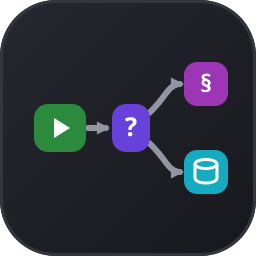
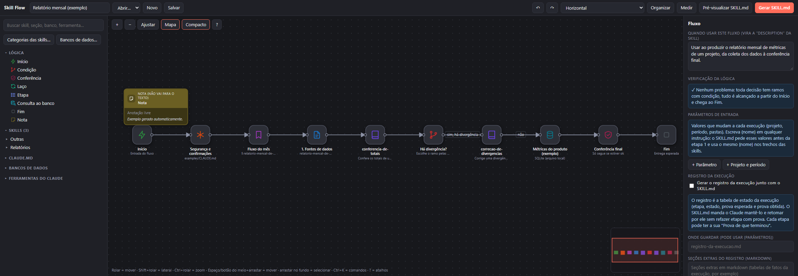
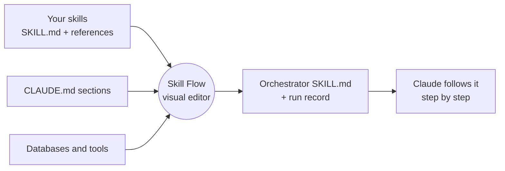
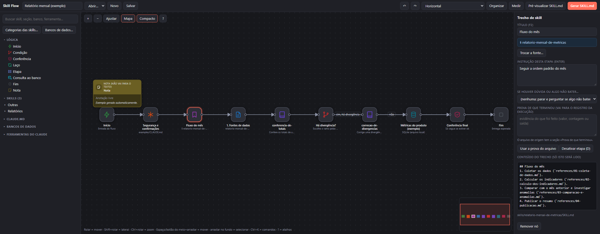
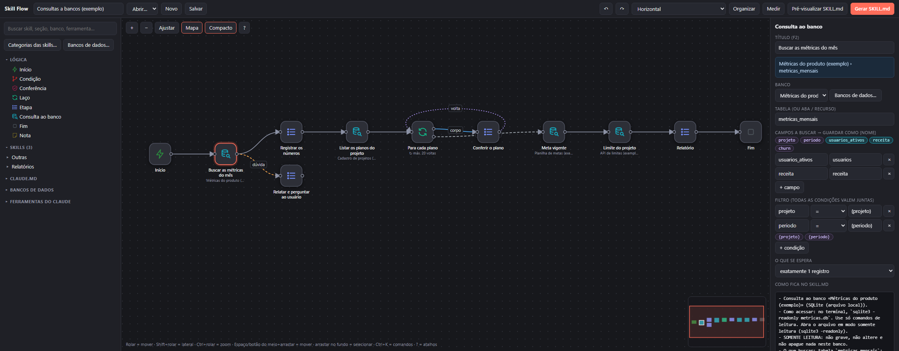

<div align="center">



# Skill Flow

**Draw how Claude should do a job, step by step and branch by branch, and get a skill it can actually follow.**

[](LICENSE)
[](#requirements)
[](#requirements)
[](SECURITY.md)
[](#install)

**English** · [Português](README.pt-BR.md)



</div>

---

## Why Skill Flow?

Skills are great, until a routine has *order*, *branches* and *proof of completion*. A long `SKILL.md` makes Claude load everything at once, and prose like "if X then do Y, otherwise stop and ask" is easy to misread, skip or forget halfway through.

Skill Flow lets you **draw the routine** on a canvas and then **compiles it into a single orchestrator skill** that tells Claude, in a numbered list:

- which step comes next and which exact **section** of which skill (or `CLAUDE.md`) to read, instead of loading the whole file;
- which **branch** to take on each decision, what evidence to look at, and what to do when it is not sure (stop and ask, or follow the *doubt* exit you drew);
- what counts as **proof** that a step is done, written into a **run record** so the work can be resumed in another conversation without redoing anything.

You keep your skills exactly where they are. The flow only *points* at them.

> **Note on language:** the interface and the text it generates for Claude are currently in **Brazilian Portuguese**. README, CONTRIBUTING and SECURITY are bilingual; `docs/` is in English; the changelog and the code comments are in Portuguese. Translations are welcome, see [CONTRIBUTING](CONTRIBUTING.md).

## What you get

- 🧩 **A node canvas** with drag-and-connect, groups, notes, multi-select, copy/paste, undo/redo, a minimap, a command bar (<kbd>Ctrl</kbd>+<kbd>K</kbd>) and automatic horizontal layout, with parallel branches side by side.
- 📚 **Precise sources.** A node can be a whole skill, **one section** of a skill, one of its reference files, one section of a `CLAUDE.md`, a tool, a database or a free-form instruction.
- 🔀 **Real logic.** Decisions with a written condition per branch, checks that must pass, a *doubt* exit, `for each` and `repeat until` loops with a turn limit, and sub-flows that reuse other flows.
- 🧮 **Parameters.** Write `{project}` (any lowercase name works) in any instruction; the generated skill asks for the values first. Derived values (month, year, first and last day) are computed from a period like `08/2026`.
- 🗄️ **Database queries.** Declare your databases once (local or cloud, through MCP, a command, a file or HTTP) and drop a *Database query* node: it picks columns, filters by your parameters, and stores each result as a `{name}` for later steps. See [docs/database-queries.md](docs/database-queries.md).
- ✅ **Logic checks.** The editor warns about unlabeled branches, unreachable steps, dead ends, loops without a return, and values used before the query that fills them.
- 🔍 **Change detection.** Each source section is fingerprinted. When a skill you depend on changes or disappears, the node is flagged, you see a diff, and you can accept it or **swap the source** without losing connections.
- 📏 **Measure.** Log runs done with and without the flow and compare quality.
- 🔒 **Local and private.** One small Python server bound to `127.0.0.1`, no dependencies, no network calls, and it never connects to your databases. See [SECURITY.md](SECURITY.md).

## Quick start

### Requirements

- **Python 3.9 or newer** (standard library only, nothing to `pip install`).
- A modern browser.
- [Claude Code](https://claude.com/claude-code) if you want the `/skill-flow` shortcut. The editor also runs on its own.

### Try it in one minute

```bash
git clone https://github.com/Alison-02/Skill-Flow.git
cd skill-flow
python app/server.py --data examples/data
```

Run it from the root of the clone, then open <http://127.0.0.1:8765/?demo=1>. (The example needs the `examples/` folder, so it is not available in the mod install.) The `examples/` folder holds three fictional skills, a `CLAUDE.md` and four fictional databases, so the sample flow has something to point at. Press **Preview SKILL.md** (*Pré-visualizar SKILL.md*) to see what Claude will receive, or open <http://127.0.0.1:8765/?demo=consultas> for a flow made of database queries.

### Use it with your own skills

```bash
python app/server.py
```

With no `--data`, the editor stores its files in `~/.claude/skill-flows` and discovers your skills in `~/.claude/skills` (plus your global `~/.claude/CLAUDE.md`). Add more folders in `config.json`, see [Configuration](#configuration).

### Install

<details open>
<summary><b>As a Claude Code mod</b> (recommended)</summary>

In a Claude Code session:

```text
/plugin install skill-flow --marketplace Alison-02/Skill-Flow
```

From a normal terminal, `claude plugin install skill-flow --marketplace Alison-02/Skill-Flow` does the same. Answer `y` to add the marketplace and pick a scope. (`/plugin` is not available in the desktop app.) From then on, type **`/skill-flow`**: it starts the local server, opens the editor in your browser, and shares Claude's tool list with it so tools can be dropped on the canvas as nodes.

</details>

<details>
<summary><b>Standalone</b></summary>

Clone the repository and run `python app/server.py` (add `--port 9000` to change the port, `--data <folder>` to store files elsewhere). `python app/server.py --check` prints what the server sees on your machine: Python version, data folder, skill folders and how many skills were found.

</details>

<details>
<summary><b>From a local copy while developing</b></summary>

```bash
claude --plugin-dir /path/to/skill-flow
```

</details>

## A two-minute tour

1. **Pick the sources.** Search in the left panel (<kbd>N</kbd>) and click or drag skills, skill sections, `CLAUDE.md` sections, tools and databases onto the canvas. Logic nodes (*Start*, *Condition*, *Check*, *Loop*, *Step*, *Database query*, *End*) are in the same panel.
2. **Connect them.** Drag from a node's right port to another node. On a *Condition*, write the condition on each branch ("yes, there is a difference"). Pick a *doubt* exit in the inspector if "I am not sure" should lead somewhere other than "stop and ask".
3. **Write the instructions.** Each node has an instruction field and an optional *proof of completion*. Use `{parameters}` freely.
4. **Look at the checks.** The inspector lists logic problems; click one to jump to the node.
5. **Preview and generate.** **Preview SKILL.md** shows the text; **Generate SKILL.md** writes it to `out/fluxo-<name>/SKILL.md` inside the data folder (the run record template goes next to it when you turn that option on).
6. **Use it.** Copy that folder to where your Claude loads skills (for example `~/.claude/skills/`) and ask Claude to run the flow. It is a regular skill.

## How it works



The editor never executes anything. It reads your skills, lets you wire them, and writes text. What Claude does with that text is exactly what any skill does. See [docs/generated-skill.md](docs/generated-skill.md) for a line-by-line look at the output, and [docs/example-output](docs/example-output) for complete generated files.

A taste of what the sample flow generates for a decision:

```markdown
## Etapa 6 — Condição: Há divergência?
- Decisão: Os totais do painel batem com a fonte?
- Como decidir: Compare o total do painel com o da fonte
- Prova de que terminou: a decisão tomada e o ramo escolhido
- Recebe de: etapa 5
- Depois (siga o ramo cuja condição for verdadeira):
  - sim, há divergência → etapa 7
  - não → etapa 9
  - nenhuma condição acima é verdadeira com certeza, ou há dúvida → PARE: relate as leituras possíveis,
    com a evidência de cada uma, e pergunte ao usuário. Não escolha por palpite.
```

<details>
<summary>More screenshots</summary>

**Selecting a node shows exactly what Claude will read** (and lets you swap the source):



**Database queries with a doubt exit, a list and a loop:**



</details>

## Node types

| Node | What it points at or does |
|---|---|
| **Start** / **End** | Where the flow begins (inputs) and what must be delivered. |
| **Skill** | A whole skill, loaded with the `Skill` tool. |
| **Skill section** | One heading of a `SKILL.md`, read without loading the rest. |
| **Skill reference** | A file in the skill's `references/` folder, or one section of it. |
| **CLAUDE.md section** | One heading of a `CLAUDE.md`. |
| **Tool** | A Claude tool (`Read`, `Grep`, an MCP tool...). |
| **Database** | A declared database, with how to reach it and whether it is read-only. |
| **Database query** | Columns to fetch, filters, order and the `{names}` to store results as. |
| **Step** | A free-form instruction with no source. |
| **Condition** | Chooses a branch by the label on each outgoing connection. |
| **Check** | A criterion that must hold before moving on. |
| **Loop** | `For each` item of a list, or `repeat until` a condition, with a turn limit. |
| **Sub-flow** | Reuses another saved flow; its parameters flow into yours. |
| **Note** | An annotation that stays out of the generated text. |

Keyboard shortcuts and the full list of concepts are in [docs/concepts.md](docs/concepts.md).

## Configuration

The data folder holds `config.json`, your flows (`flows/`), registered runs (`runs/`) and generated skills (`out/`):

```jsonc
// (comments are for reading only: remove them, since config.json must be plain JSON)
{
  "skillRoots": ["~/work/my-skills", "~/work/team-skills"],   // folders that contain skill folders
  "claudeMdFiles": ["~/work/CLAUDE.md"],              // extra CLAUDE.md files
  "projectRoots": ["~/work/projects"],                // each folder and its direct subfolders are searched for CLAUDE.md
  "skillCategory": { "my-skill": "Reports/Monthly" }, // how skills are grouped in the left panel
  "databases": []                                     // managed from the "Databases…" window
}
```

Relative paths are resolved from the folder that contains `config.json`, and `~` is your home folder. If `config.json` has a syntax error, the editor tells you the line and never overwrites it; a `config.json.bak` is written before every change the editor makes to it.

## Safety and privacy

- The server listens **only on `127.0.0.1`**, refuses unexpected `Host` headers and requires a custom header for every write.
- It reads only the skill and `CLAUDE.md` files it discovers and writes only inside its data folder.
- It **never connects to a database**. It describes the database so that Claude can query it through the way you declared.
- **Secrets never belong in the editor.** For API access you type only the *name* of an environment variable. Unmistakable keys (JWTs, `sk-…`, `ghp_…`, `user:password@` in a URL...) are rejected, and text that merely looks like a password asks for confirmation before being saved. This is a safety net, not a guarantee. Read [SECURITY.md](SECURITY.md).
- Nothing is sent to the internet. (Only the optional in-page self-test fetches a diagram library from a CDN.)

## FAQ

**Does Skill Flow run my flow?** No. It writes a skill; Claude runs it. That keeps everything inspectable: the generated `SKILL.md` is the whole truth.

**Does it call the Claude API?** No. There is no API key anywhere in the project.

**Will it change my skills?** No. It only reads them. The generated skill goes to its own folder.

**What if I edit a skill that a flow uses?** The editor notices (by fingerprint) and flags the node as *changed* or *missing*, shows a diff and lets you accept or swap the source.

**Does it work with the Claude desktop app?** The output is a regular skill folder, so it works wherever Claude loads skills. On Windows the editor also discovers the skills that the desktop app keeps for your account.

## Project layout

```text
app/server.py        local server: reads skills, stores flows and runs, secret detection
app/index.html       the whole editor (HTML, CSS and JavaScript) plus its in-page self-test
hooks/               the /skill-flow command for Claude Code
examples/            fictional skills, CLAUDE.md and databases for the demo and the tests
tests/               server tests, editor self-test and change-detection test
docs/                concepts, database queries, generated-skill walkthrough, screenshots
```

## Development

```bash
python tests/test_server.py          # secret detection, config safety, paths
python tests/test_editor.py          # ~450 checks in headless Chrome, Chromium or Edge
python tests/test_content_drift.py   # change detection, end to end
claude plugin test .                 # the /skill-flow launcher
python docs/make_screenshots.py      # regenerate docs/images/*.png
```

The tests run against a temporary copy of `examples/` with a fake home folder, so they never touch your real skills or flows. More in [CONTRIBUTING.md](CONTRIBUTING.md).

## Roadmap

Ideas, not promises: an English interface and generated text (selectable per flow), importing and exporting flows as files you can share, and a visual diff between two generated skills. Open an issue to discuss or vote.

## Contributing

Issues and pull requests are welcome. Please read [CONTRIBUTING.md](CONTRIBUTING.md) first; the short version is *no dependencies, no secrets, fictional data only*.

## License

[MIT](LICENSE).

## Acknowledgements

The canvas takes its interaction cues from node-based workflow editors, and the idea of keeping a durable run record comes from the pain of resuming long jobs across conversations.
