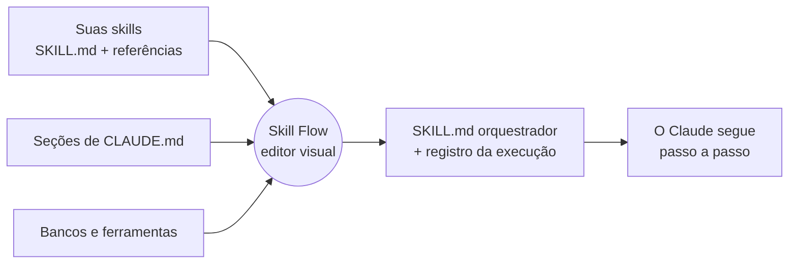

<div align="center">


# Skill Flow

**Desenhe como o Claude deve fazer um trabalho, passo a passo e ramo a ramo, e receba uma skill que ele consegue seguir de verdade.**

[](LICENSE)
[](#requisitos)
[](#requisitos)
[](SECURITY.md)
[](#instalar)

[English](README.md) · **Português**


</div>

---

## Por que o Skill Flow?

Skills são ótimas, até que uma rotina tenha *ordem*, *ramificações* e *prova de conclusão*. Um `SKILL.md` longo faz o Claude carregar tudo de uma vez, e frases como "se X faça Y, senão pare e pergunte" são fáceis de ler errado, pular ou esquecer no meio do caminho.

O Skill Flow deixa você **desenhar a rotina** num canvas e **compila o desenho numa única skill orquestradora**, que diz ao Claude, numa lista numerada:

- qual é o próximo passo e qual **seção** exata de qual skill (ou `CLAUDE.md`) ler, em vez de carregar o arquivo inteiro;
- qual **ramo** seguir em cada decisão, qual evidência olhar e o que fazer na dúvida (parar e perguntar, ou seguir a **saída de dúvida** que você desenhou);
- o que vale como **prova** de que um passo terminou, anotada num **registro da execução** que permite retomar o trabalho em outra conversa sem refazer nada.

Suas skills continuam onde estão. O fluxo só *aponta* para elas.

> **Sobre o idioma:** a interface e o texto que ela gera para o Claude estão, por enquanto, em **português do Brasil**. README, CONTRIBUTING e SECURITY são bilíngues; `docs/` está em inglês; o changelog e os comentários do código estão em português. Traduções são bem-vindas, veja o [CONTRIBUTING](CONTRIBUTING.md).

## O que você recebe

- 🧩 **Um canvas de nós** com arrastar e ligar, grupos, notas, seleção múltipla, copiar e colar, desfazer e refazer, minimapa, barra de comandos (<kbd>Ctrl</kbd>+<kbd>K</kbd>) e organização automática na horizontal, com ramos paralelos lado a lado.
- 📚 **Fontes precisas.** Um nó pode ser uma skill inteira, **uma seção** de uma skill, um dos arquivos de referência dela, uma seção de um `CLAUDE.md`, uma ferramenta, um banco de dados ou uma instrução livre.
- 🔀 **Lógica de verdade.** Decisões com uma condição escrita por ramo, conferências que precisam passar, uma **saída de dúvida**, laços «para cada» e «repita até» com limite de voltas, e subfluxos que reaproveitam outros fluxos.
- 🧮 **Parâmetros.** Escreva `{projeto}` em qualquer instrução; a skill gerada pede os valores antes. Valores derivados (mês, ano, primeiro e último dia) saem de um período como `08/2026`.
- 🗄️ **Consultas a bancos.** Declare seus bancos uma vez (local ou na nuvem, por MCP, comando, arquivo ou HTTP) e use o nó *Consulta ao banco*: ele escolhe colunas, filtra pelos seus parâmetros e guarda cada resultado como um `{nome}` para as etapas seguintes. Veja [docs/database-queries.md](docs/database-queries.md) (em inglês).
- ✅ **Verificação da lógica.** O editor avisa de ramos sem condição, etapas inalcançáveis, becos sem saída, laços sem retorno e valores usados antes da consulta que os preenche.
- 🔍 **Detecção de mudança.** Cada seção usada tem uma impressão digital. Se uma skill da qual você depende mudar ou sumir, o nó é marcado, você vê a diferença e pode aceitar ou **trocar a fonte** sem perder as conexões.
- 📏 **Medir.** Registre execuções feitas com e sem o fluxo e compare a qualidade.
- 🔒 **Local e privado.** Um pequeno servidor em Python preso a `127.0.0.1`, sem dependências, sem chamadas de rede, que nunca conecta aos seus bancos. Veja o [SECURITY.md](SECURITY.md).

## Começando

### Requisitos

- **Python 3.9 ou mais novo** (só a biblioteca padrão, nada para instalar com `pip`).
- Um navegador moderno.
- O [Claude Code](https://claude.com/claude-code), se quiser o atalho `/skill-flow`. O editor também roda sozinho.

### Experimente em um minuto

```bash
git clone https://github.com/Alison-02/Skill-Flow.git
cd skill-flow
python app/server.py --data examples/data
```

Abra <http://127.0.0.1:8765/?demo=1>. A pasta `examples/` traz três skills fictícias, um `CLAUDE.md` e quatro bancos fictícios, para o fluxo de exemplo ter o que apontar. Clique em **Pré-visualizar SKILL.md** para ver o que o Claude vai receber, ou abra <http://127.0.0.1:8765/?demo=consultas> para um fluxo feito de consultas a bancos.

### Use com as suas skills

```bash
python app/server.py
```

Sem `--data`, o editor guarda seus arquivos em `~/.claude/skill-flows` e descobre suas skills em `~/.claude/skills` (e o seu `~/.claude/CLAUDE.md` global). Para incluir outras pastas, edite o `config.json`, veja [Configuração](#configuração).

### Instalar

<details open>
<summary><b>Como mod do Claude Code</b> (recomendado)</summary>

Numa sessão do Claude Code:

```text
/plugin install skill-flow --marketplace Alison-02/Skill-Flow
```

Num terminal comum, `claude plugin install skill-flow --marketplace Alison-02/Skill-Flow` faz o mesmo. Responda `y` para adicionar o marketplace e escolha o escopo. Depois disso, digite **`/skill-flow`**: ele sobe o servidor local, abre o editor no navegador e compartilha a lista de ferramentas do Claude, para que elas possam virar nós no canvas.

</details>

<details>
<summary><b>Sozinho (sem o Claude Code)</b></summary>

Clone o repositório e rode `python app/server.py` (use `--port 9000` para mudar a porta e `--data <pasta>` para guardar os arquivos em outro lugar). `python app/server.py --check` mostra o que o servidor enxerga na sua máquina: versão do Python, pasta de dados, pastas de skills e quantas skills foram encontradas.

</details>

<details>
<summary><b>A partir de uma cópia local, para desenvolver</b></summary>

```bash
claude --plugin-dir /caminho/para/skill-flow
```

</details>

## Um passeio de dois minutos

1. **Escolha as fontes.** Busque no painel da esquerda (<kbd>N</kbd>) e clique ou arraste skills, seções de skills, seções de `CLAUDE.md`, ferramentas e bancos para o canvas. Os nós de lógica (*Início*, *Condição*, *Conferência*, *Laço*, *Etapa*, *Consulta ao banco*, *Fim*) estão no mesmo painel.
2. **Ligue os nós.** Arraste da porta direita de um nó até outro. Numa *Condição*, escreva a condição em cada ramo ("sim, há divergência"). Escolha uma *saída de dúvida* no painel de detalhes se "não tenho certeza" deve levar a outro lugar que não "parar e perguntar".
3. **Escreva as instruções.** Cada nó tem um campo de instrução e uma *prova de que terminou* opcional. Use `{parâmetros}` à vontade.
4. **Olhe a verificação.** O painel de detalhes lista problemas de lógica; clique num para ir até o nó.
5. **Pré-visualize e gere.** **Pré-visualizar SKILL.md** mostra o texto; **Gerar SKILL.md** grava em `out/fluxo-<nome>/SKILL.md`, dentro da pasta de dados (o modelo do registro da execução vai ao lado quando você liga essa opção).
6. **Use.** Copie essa pasta para onde o seu Claude carrega skills (por exemplo `~/.claude/skills/`) e peça ao Claude para executar o fluxo. É uma skill comum.

## Como funciona



O editor nunca executa nada. Ele lê suas skills, deixa você ligá-las e escreve texto. O que o Claude faz com esse texto é exatamente o que ele faz com qualquer skill. Veja [docs/generated-skill.md](docs/generated-skill.md) (em inglês) para um passeio pela saída, e [docs/example-output](docs/example-output) para arquivos completos gerados.

Um gostinho do que o fluxo de exemplo gera para uma decisão:

```markdown
## Etapa 6 — Condição: Há divergência?
- Decisão: Os totais do painel batem com a fonte?
- Como decidir: Compare o total do painel com o da fonte
- Prova de que terminou: a decisão tomada e o ramo escolhido
- Recebe de: etapa 5
- Depois (siga o ramo cuja condição for verdadeira):
  - sim, há divergência → etapa 7
  - não → etapa 9
  - nenhuma condição acima é verdadeira com certeza, ou há dúvida → PARE: relate as leituras possíveis,
    com a evidência de cada uma, e pergunte ao usuário. Não escolha por palpite.
```

<details>
<summary>Mais capturas de tela</summary>

**Selecionar um nó mostra exatamente o que o Claude vai ler** (e permite trocar a fonte):


**Consultas a bancos com saída de dúvida, lista e laço:**


</details>

## Tipos de nó

| Nó | Para o que aponta ou o que faz |
|---|---|
| **Início** / **Fim** | Onde o fluxo começa (entradas) e o que precisa ser entregue. |
| **Skill inteira** | Uma skill completa, carregada com a ferramenta `Skill`. |
| **Trecho de skill** | Um título de um `SKILL.md`, lido sem carregar o resto. |
| **Referência da skill** | Um arquivo da pasta `references/` da skill, ou uma seção dele. |
| **Trecho do CLAUDE.md** | Um título de um `CLAUDE.md`. |
| **Ferramenta** | Uma ferramenta do Claude (`Read`, `Grep`, uma ferramenta MCP...). |
| **Banco de dados** | Um banco declarado, com a forma de acesso e se é somente leitura. |
| **Consulta ao banco** | Colunas a buscar, filtros, ordem e os `{nomes}` em que guardar os resultados. |
| **Etapa** | Uma instrução livre, sem fonte. |
| **Condição** | Escolhe um ramo pelo rótulo de cada conexão de saída. |
| **Conferência** | Um critério que precisa valer antes de seguir. |
| **Laço** | *Para cada* item de uma lista, ou *repita até* uma condição, com limite de voltas. |
| **Subfluxo** | Reaproveita outro fluxo salvo; os parâmetros dele passam para o seu. |
| **Nota** | Uma anotação que não vai para o texto gerado. |

Atalhos de teclado e a lista completa de conceitos estão em [docs/concepts.md](docs/concepts.md) (em inglês).

## Configuração

A pasta de dados guarda o `config.json`, seus fluxos (`flows/`), as execuções registradas (`runs/`) e as skills geradas (`out/`):

```jsonc
{
  "skillRoots": ["~/trabalho/minhas-skills", "~/trabalho/skills-da-equipe"],   // pastas que contêm pastas de skills
  "claudeMdFiles": ["~/trabalho/CLAUDE.md"],                  // CLAUDE.md extras
  "projectRoots": ["~/trabalho/projetos"],                    // varridas em dois níveis atrás de CLAUDE.md
  "skillCategory": { "minha-skill": "Relatórios/Mensal" },    // como as skills são agrupadas no painel
  "databases": []                                             // gerenciado pela janela "Bancos de dados…"
}
```

Caminhos relativos valem a partir da pasta que contém o `config.json`, e `~` é a sua pasta pessoal. Se o `config.json` tiver erro de sintaxe, o editor mostra a linha e nunca o sobrescreve; um `config.json.bak` é gravado antes de cada alteração feita pelo editor.

## Segurança e privacidade

- O servidor escuta **somente em `127.0.0.1`**, recusa cabeçalhos `Host` inesperados e exige um cabeçalho próprio em toda gravação.
- Ele só lê os arquivos de skill e de `CLAUDE.md` que descobre e só grava dentro da pasta de dados.
- **Nunca conecta a um banco de dados.** Ele descreve o banco para que o Claude o consulte pelo meio que você declarou.
- **Segredos não entram no editor.** Para acesso por API, você digita só o *nome* de uma variável de ambiente. Credenciais inconfundíveis (JWT, `sk-…`, `ghp_…`, `usuario:senha@` numa URL...) são recusadas, e texto que apenas *parece* senha pede confirmação antes de ser salvo. É uma rede de proteção, não uma garantia. Leia o [SECURITY.md](SECURITY.md).
- Nada é enviado à internet. (Só o autoteste opcional da página busca uma biblioteca de diagramas numa CDN.)

## Perguntas frequentes

**O Skill Flow executa o meu fluxo?** Não. Ele escreve uma skill; quem executa é o Claude. Assim tudo fica auditável: o `SKILL.md` gerado é a verdade inteira.

**Ele chama a API do Claude?** Não. Não existe chave de API em lugar nenhum do projeto.

**Ele altera as minhas skills?** Não, só lê. A skill gerada vai para uma pasta própria.

**E se eu editar uma skill usada por um fluxo?** O editor percebe (pela impressão digital) e marca o nó como *mudou* ou *sumiu*, mostra a diferença e deixa você aceitar ou trocar a fonte.

**Funciona com o aplicativo desktop do Claude?** A saída é uma pasta de skill comum, então funciona onde o Claude carregar skills. No Windows, o editor também descobre as skills que o aplicativo desktop guarda para a sua conta.

## Estrutura do projeto

```text
app/server.py        servidor local: lê skills, guarda fluxos e execuções, detecta segredos
app/index.html       o editor inteiro (HTML, CSS e JavaScript) e o autoteste da página
hooks/               o comando /skill-flow para o Claude Code
examples/            skills, CLAUDE.md e bancos fictícios para a demonstração e os testes
tests/               testes do servidor, autoteste do editor e teste de detecção de mudança
docs/                conceitos, consultas a bancos, passeio pela skill gerada, capturas de tela
```

## Desenvolvimento

```bash
python tests/test_server.py          # detecção de segredos, segurança do config, caminhos
python tests/test_editor.py          # ~450 verificações em Chrome, Chromium ou Edge sem janela
python tests/test_content_drift.py   # detecção de mudança, de ponta a ponta
claude plugin test .                 # o atalho /skill-flow
python docs/make_screenshots.py      # regenera docs/images/*.png
```

Os testes rodam sobre uma cópia temporária de `examples/` e com uma pasta pessoal falsa, então nunca tocam nas suas skills ou fluxos de verdade. Mais detalhes no [CONTRIBUTING.md](CONTRIBUTING.md).

## Roteiro

Ideias, não promessas: interface e texto gerado em inglês (selecionáveis por fluxo), importar e exportar fluxos como arquivos compartilháveis e uma comparação visual entre duas skills geradas. Abra uma issue para conversar ou votar.

## Contribuindo

Issues e pull requests são bem-vindos. Leia antes o [CONTRIBUTING.md](CONTRIBUTING.md); a versão curta é *sem dependências, sem segredos, só dados fictícios*.

## Licença

[MIT](LICENSE).

## Agradecimentos

O canvas se inspira na interação de editores de fluxo baseados em nós, e a ideia de manter um registro durável da execução nasceu da dor de retomar trabalhos longos entre conversas.
