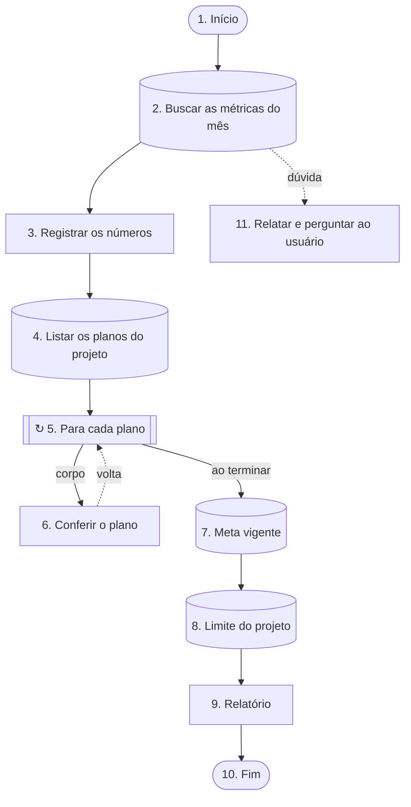

# Fluxo: Consultas a bancos (exemplo)

## Como executar
1. Execute as etapas abaixo NA ORDEM, uma de cada vez. Não pule nem reordene.
2. Use SOMENTE a fonte indicada em cada etapa. Onde estiver escrito "leia apenas a seção", NÃO carregue a skill nem o arquivo inteiro.
3. Seção = do título indicado até o próximo título de mesmo nível ou superior. Localize pelo TÍTULO (Grep no arquivo); números de linha são só dica e podem ter mudado.
4. Ao fim de cada etapa, confira você mesmo a "Prova de que terminou" (quando houver) antes de seguir; não é preciso perguntar ao usuário, a não ser que a etapa mande. Se uma fonte não existir ou algo não bater, pare e pergunte ao usuário. Não invente.
5. Bancos de dados: quando a etapa der o ID do banco no provedor, use-o para escolher o banco. Em banco marcado SOMENTE LEITURA não grave nada, nem com confirmação; nos demais, escrita só com confirmação explícita. Senhas e chaves: nunca peça, mostre, escreva ou registre o VALOR; quando a etapa indicar uma variável de ambiente, use-a só pela referência (ex.: $NOME ou %NOME%) e use só o acesso que a etapa indica.
6. Ramos: numa etapa com mais de um caminho, siga SOMENTE o ramo cuja condição for verdadeira, com a evidência à vista. Se nenhuma condição for certa, ou se duas parecerem valer, NÃO escolha por palpite: siga a saída de dúvida da etapa ou, se ela não tiver, pare e pergunte ao usuário. As etapas dos outros ramos ficam de fora até o ponto em que os ramos se juntam (etapa cuja linha "Recebe de" tem mais de uma origem).
7. Caminho percorrido: a cada ramo escolhido, diga em uma linha "Etapa N → «ramo» porque <evidência>" e anote-a em «Caminho percorrido» no registro. Ao terminar, entregue o caminho completo junto com o resultado.
8. Laços: numa etapa de laço, execute o corpo inteiro, volte à etapa do laço e confira a condição (ou o próximo item). Conte as voltas e respeite o limite de segurança: se estourar, pare e pergunte. Em cada volta, diga o que foi feito.

## Entradas (obtenha ANTES da etapa 1)
Pergunte ao usuário os obrigatórios que faltarem e confirme os valores com ele; não suponha. Os opcionais, só quando a etapa que os usa chegar. Onde aparecer `{nome}` nas etapas ou nos trechos lidos das skills, use o valor informado.

- `{projeto}` — Projeto (obrigatório) — código do projeto
- `{periodo}` — Período (MM/AAAA) (obrigatório)

## Mapa do fluxo
Visão geral para se orientar antes de começar (visualizadores de Markdown com suporte a Mermaid, como o GitHub, desenham este diagrama). Losango = decisão; hexágono = conferência; tracejado = dúvida ou volta de laço. O que vale são as etapas numeradas abaixo.

## Registro da execução
Mantenha o registro desta execução em `registro-da-execucao.md` (na pasta de trabalho atual, a mesma em que você está trabalhando). O modelo em branco é o arquivo `registro-da-execucao.md`, na mesma pasta deste SKILL.md: no início, copie-o para o caminho acima (se ainda não existir) e preencha a cópia — nunca o modelo — começando pelo cabeçalho e pelas Entradas.
1. Ao começar, procure o registro. Se existir, leia o «Caminho percorrido» e o Estado das etapas e RETOME pelo «Caminho percorrido»: continue do ponto em que ele parou, seguindo os ramos já anotados. Etapas "pular" não se retomam; etapa com prova não se refaz, exceto o corpo de um laço numa volta nova (as marcas "feito" e "pular" de voltas anteriores não valem para a volta nova; a volta atual fica em "Observação" na linha do laço). Confirme com o usuário o ponto de retomada.
2. Ao terminar cada etapa, na tabela "Estado das etapas": troque o Estado para "feito (com prova)" e escreva a PROVA OBTIDA (valor, contagem ou mensagem retornada) em "Prova obtida". Sem prova, a etapa não está feita.
3. Etapa parada por divergência, pendência ou falta de liberação: Estado "bloqueado (motivo)" e a linha correspondente em "Pendências". Nunca ajuste o resultado só para a etapa passar.
4. Em laços, anote o número de voltas em "Observação".
5. Registre, com data, cada liberação expressa do usuário, cada gravação (o que foi criado ou alterado, e onde) e cada decisão, nas seções próprias.
6. A conferência final só passa com toda etapa "feito (com prova)", "pular" ou "bloqueado (motivo)" já listado nas pendências.
7. Em toda etapa com mais de um caminho (decisão, conferência, laço), anote em «Caminho percorrido» o ramo escolhido e a evidência que decidiu, e marque "pular" nas etapas dos outros ramos (até onde eles se juntam). Se seguiu a saída de dúvida ou parou para perguntar, anote também.

## Etapa 1 — Início: Início
- Entrada: Entradas: {projeto} e {periodo}.
- Depois: vá para a etapa 2.

## Etapa 2 — Consulta ao banco: Buscar as métricas do mês
- Consulta ao banco «Métricas do produto (exemplo)» (SQLite (arquivo local)).
- Como acessar: no terminal, `sqlite3 -readonly metricas.db`. Use só comandos de leitura. Abra o arquivo em modo somente leitura (sqlite3 -readonly).
- SOMENTE LEITURA: não grave, não altere e não apague nada neste banco.
- O que buscar: tabela `metricas_mensais`; campos `usuarios_ativos`, `receita`.
- Filtro: `projeto` = `{projeto}` E `periodo` = `{periodo}`.
- Esperado: exatamente 1 registro (se vierem 2 ou mais, é "mais de um").
- Consulta sugerida (troque os {nomes} pelos valores informados, dobrando as aspas simples): `SELECT usuarios_ativos, receita FROM metricas_mensais WHERE projeto = '{projeto}' AND periodo = '{periodo}' LIMIT 2;`
- Guarde o resultado: `usuarios_ativos` → {usuarios}; `receita` → {receita}. Use esses valores onde eles aparecerem nas etapas seguintes; não os invente nem os altere.
- Recebe de: etapa 1
- Depois: vá para a etapa 3.
- Se não encontrar, vier mais de um ou der erro de acesso: vá para a etapa 11.

## Etapa 3 — Etapa (instrução): Registrar os números
- Faça: Escreva no relatório os usuários ativos {usuarios} e a receita {receita} do período.
- Recebe de: etapa 2
- Depois: vá para a etapa 4.

## Etapa 4 — Consulta ao banco: Listar os planos do projeto
- Consulta ao banco «Cadastro de projetos (exemplo)» (PostgreSQL).
- Como acessar: ferramenta MCP `mcp__exemplo__executar_sql`. Se ela não estiver nesta sessão (procure também entre as ferramentas que precisam ser carregadas antes do uso), PARE e avise o usuário; não tente outro caminho.
- SOMENTE LEITURA: não grave, não altere e não apague nada neste banco.
- O que buscar: tabela `planos`; campos `plano`.
- Filtro: `projeto` = `{projeto}` E `ativo` = `sim`.
- Esperado: a lista de registros (lista vazia conta como "não encontrou").
- Consulta sugerida (troque os {nomes} pelos valores informados, dobrando as aspas simples): `SELECT plano FROM planos WHERE projeto = '{projeto}' AND ativo = 'sim' LIMIT 200;`
- Guarde a lista como {planos} (um item por registro, com os campos acima) e use-a onde {planos} aparecer nas etapas seguintes, por exemplo num laço "para cada".
- Em cada item da lista: `plano` → {plano_item} (valem para o item da volta atual).
- Se vierem 200 registros (o limite), pode haver mais: PARE e pergunte ao usuário antes de seguir.
- Se a lista vier vazia ou der erro de acesso: PARE e pergunte ao usuário. Não invente valores.
- Recebe de: etapa 3
- Depois: vá para a etapa 5.

## Etapa 5 — Laço: Para cada plano
- LAÇO: para CADA plano da lista {planos}, execute o corpo (etapa 6) e depois volte a esta etapa para o próximo.
- Limite de segurança: no máximo 20 volta(s). Se atingir o limite sem esgotar a lista, PARE e pergunte ao usuário; não force.
- Corpo do laço: comece pela etapa 6.
- O fim do corpo volta a esta etapa (retorno vindo da etapa 6).
- Recebe de: etapa 4
- Ao terminar: vá para a etapa 7.

## Etapa 6 — Etapa (instrução): Conferir o plano
- Faça: Confira os números do plano da volta atual ({plano_item}) contra o painel.
- Dentro do laço: etapa 5
- Recebe de: etapa 5
- Depois: volte à etapa 5 (próxima volta do laço).

## Etapa 7 — Consulta ao banco: Meta vigente
- Consulta ao banco «Planilha de metas (exemplo)» (Planilha (xlsx / csv)).
- Como acessar: abra o arquivo `metas.xlsx`, aba `Metas` e filtre as linhas (planilha: use Python se precisar).
- SOMENTE LEITURA: não grave, não altere e não apague nada neste banco.
- O que buscar: tabela `Metas`; campos `meta_receita`.
- Filtro: `projeto` = `{projeto}`.
- Ordem: `vigencia` decrescente; use só o primeiro registro, ignorando os que não têm valor em `vigencia`.
- Esperado: o primeiro registro da ordem acima.
- Guarde o resultado: `meta_receita` → {meta}. Use esses valores onde eles aparecerem nas etapas seguintes; não os invente nem os altere.
- Se não encontrar ou der erro de acesso: PARE e pergunte ao usuário. Não invente valores.
- Recebe de: etapa 5 (ao terminar o laço)
- Depois: vá para a etapa 8.

## Etapa 8 — Consulta ao banco: Limite do projeto
- Consulta ao banco «API de limites (exemplo)» (API / HTTP).
- Como acessar: requisição GET a `https://api.exemplo.invalid/limites`, com a chave da variável de ambiente `EXEMPLO_API_CHAVE` (use-a pela referência, ex.: $EXEMPLO_API_CHAVE, no cabeçalho que a API pede). Nunca escreva o valor da chave no texto, no registro nem na resposta.
- SOMENTE LEITURA: não grave, não altere e não apague nada neste banco.
- O que buscar: tabela `limites`; campos `limite`.
- Passe os filtros como parâmetros da requisição, com os valores codificados para URL (espaço, %, apóstrofo e afins).
- Filtro: `projeto` = `{projeto}`.
- Esperado: exatamente 1 registro (se vierem 2 ou mais, é "mais de um").
- Guarde o resultado: `limite` → {limite}. Use esses valores onde eles aparecerem nas etapas seguintes; não os invente nem os altere.
- Se não encontrar, vier mais de um ou der erro de acesso: PARE e pergunte ao usuário. Não invente valores.
- Recebe de: etapa 7
- Depois: vá para a etapa 9.

## Etapa 9 — Etapa (instrução): Relatório
- Faça: Entregue: usuários ativos {usuarios}, receita {receita}, meta {meta}, limite {limite} e os planos conferidos.
- Recebe de: etapa 8
- Depois: vá para a etapa 10.

## Etapa 10 — Fim: Fim
- Entrega: resuma o que foi feito e as pendências.
- Recebe de: etapa 9

## Etapa 11 — Etapa (instrução): Relatar e perguntar ao usuário
- Faça: Relate o que a consulta devolveu (nada, mais de um ou erro) e espere a decisão do usuário. Não escolha por palpite.
- Recebe de: etapa 2
- Depois: com a decisão do usuário, siga para a etapa 3 usando para {usuarios}, {receita} os valores que ele indicar; se ele corrigir a entrada, refaça a etapa 2 (anote no caminho percorrido). Se ele não decidir agora, PARE aqui: este é o ponto de retomada.
