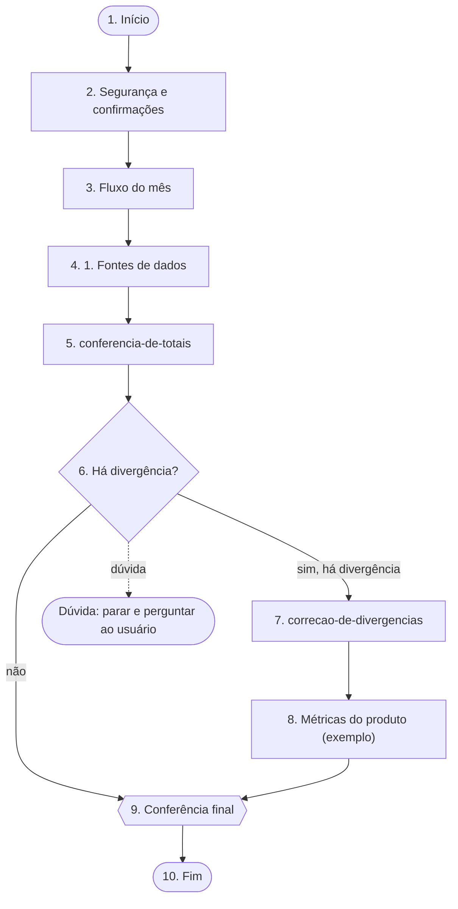

# Fluxo: Relatório mensal (exemplo)

## Como executar
1. Execute as etapas abaixo NA ORDEM, uma de cada vez. Não pule nem reordene.
2. Use SOMENTE a fonte indicada em cada etapa. Onde estiver escrito "leia apenas a seção", NÃO carregue a skill nem o arquivo inteiro.
3. Seção = do título indicado até o próximo título de mesmo nível ou superior. Localize pelo TÍTULO (Grep no arquivo); números de linha são só dica e podem ter mudado.
4. Ao fim de cada etapa, confira você mesmo a "Prova de que terminou" (quando houver) antes de seguir; não é preciso perguntar ao usuário, a não ser que a etapa mande. Se uma fonte não existir ou algo não bater, pare e pergunte ao usuário. Não invente.
5. Bancos de dados: quando a etapa der o ID do banco no provedor, use-o para escolher o banco. Em banco marcado SOMENTE LEITURA não grave nada, nem com confirmação; nos demais, escrita só com confirmação explícita. Senhas e chaves: nunca peça, mostre, escreva ou registre o VALOR; quando a etapa indicar uma variável de ambiente, use-a só pela referência (ex.: $NOME ou %NOME%) e use só o acesso que a etapa indica.
6. Ramos: numa etapa com mais de um caminho, siga SOMENTE o ramo cuja condição for verdadeira, com a evidência à vista. Se nenhuma condição for certa, ou se duas parecerem valer, NÃO escolha por palpite: siga a saída de dúvida da etapa ou, se ela não tiver, pare e pergunte ao usuário. As etapas dos outros ramos ficam de fora até o ponto em que os ramos se juntam (etapa cuja linha "Recebe de" tem mais de uma origem).
7. Caminho percorrido: a cada ramo escolhido, diga em uma linha "Etapa N → «ramo» porque <evidência>" e anote-a em «Caminho percorrido» no registro. Ao terminar, entregue o caminho completo junto com o resultado.
8. `{SKILLS}` = `/caminho/para/skill-flow/examples/skills` (onde aparecer {SKILLS} num caminho, leia este prefixo).

## Mapa do fluxo
Visão geral para se orientar antes de começar (visualizadores de Markdown com suporte a Mermaid, como o GitHub, desenham este diagrama). Losango = decisão; hexágono = conferência; tracejado = dúvida ou volta de laço. O que vale são as etapas numeradas abaixo.

## Registro da execução
Mantenha o registro desta execução em `registro-da-execucao.md` (na pasta de trabalho atual, a mesma em que você está trabalhando). O modelo em branco é o arquivo `registro-da-execucao.md`, na mesma pasta deste SKILL.md: no início, copie-o para o caminho acima (se ainda não existir) e preencha a cópia — nunca o modelo — começando pelo cabeçalho e pelas Entradas.
1. Ao começar, procure o registro. Se existir, leia o «Caminho percorrido» e o Estado das etapas e RETOME pelo «Caminho percorrido»: continue do ponto em que ele parou, seguindo os ramos já anotados. Etapas "pular" não se retomam; etapa com prova não se refaz, exceto o corpo de um laço numa volta nova (as marcas "feito" e "pular" de voltas anteriores não valem para a volta nova; a volta atual fica em "Observação" na linha do laço). Confirme com o usuário o ponto de retomada.
2. Ao terminar cada etapa, na tabela "Estado das etapas": troque o Estado para "feito (com prova)" e escreva a PROVA OBTIDA (valor, contagem ou mensagem retornada) em "Prova obtida". Sem prova, a etapa não está feita.
3. Etapa parada por divergência, pendência ou falta de liberação: Estado "bloqueado (motivo)" e a linha correspondente em "Pendências". Nunca ajuste o resultado só para a etapa passar.
4. Em laços, anote o número de voltas em "Observação".
5. Registre, com data, cada liberação expressa do usuário, cada gravação (o que foi criado ou alterado, e onde) e cada decisão, nas seções próprias.
6. A conferência final só passa com toda etapa "feito (com prova)", "pular" ou "bloqueado (motivo)" já listado nas pendências.
7. Em toda etapa com mais de um caminho (decisão, conferência, laço), anote em «Caminho percorrido» o ramo escolhido e a evidência que decidiu, e marque "pular" nas etapas dos outros ramos (até onde eles se juntam). Se seguiu a saída de dúvida ou parou para perguntar, anote também.

## Etapa 1 — Início: Início
- Entrada: Projeto e período informados pelo usuário
- Depois: vá para a etapa 2.

## Etapa 2 — Trecho do CLAUDE.md: Segurança e confirmações (CLAUDE.md)
- Leia apenas a seção «Segurança e confirmações» de `/caminho/para/skill-flow/examples/CLAUDE.md` (linhas ≈ 5–9; se não bater, localize pelo título) e aplique-a como regra.
- Nesta etapa: Regra de confirmação antes de publicar ou apagar
- Recebe de: etapa 1
- Depois: vá para a etapa 3.

## Etapa 3 — Trecho de skill: Fluxo do mês (relatorio-mensal-de-metricas)
- NÃO carregue a skill `relatorio-mensal-de-metricas` inteira. Leia apenas a seção «Fluxo do mês» do arquivo `{SKILLS}/relatorio-mensal-de-metricas/SKILL.md` (linhas ≈ 19–24; se não bater, localize pelo título).
- Aplique só o que essa seção diz; se ela remeter a outra referência, abra apenas a remissão.
- Nesta etapa: Seguir a ordem padrão do mês
- Recebe de: etapa 2
- Depois: vá para a etapa 4.

## Etapa 4 — Referência da skill: 1. Fontes de dados (relatorio-mensal-de-metricas › 01-coleta-de-dados.md)
- Leia apenas a seção «1. Fontes de dados» do arquivo de referência `{SKILLS}/relatorio-mensal-de-metricas/references/01-coleta-de-dados.md` (linhas ≈ 5–9; se não bater, localize pelo título).
- Nesta etapa: Coletar e conferir os dados
- Recebe de: etapa 3
- Depois: vá para a etapa 5.

## Etapa 5 — Skill inteira: conferencia-de-totais
- Carregue a skill `conferencia-de-totais` com a ferramenta Skill e siga-a.
- Nesta etapa: Conferir os totais antes de publicar
- Recebe de: etapa 4
- Depois: vá para a etapa 6.

## Etapa 6 — Condição: Há divergência?
- Decisão: Os totais do painel batem com a fonte?
- Como decidir: Compare o total do painel com o da fonte
- Prova de que terminou: a decisão tomada e o ramo escolhido
- Recebe de: etapa 5
- Depois (siga o ramo cuja condição for verdadeira):
  - sim, há divergência → etapa 7
  - não → etapa 9
  - nenhuma condição acima é verdadeira com certeza, ou há dúvida → PARE: relate as leituras possíveis, com a evidência de cada uma, e pergunte ao usuário. Não escolha por palpite.

## Etapa 7 — Skill inteira: correcao-de-divergencias
- Carregue a skill `correcao-de-divergencias` com a ferramenta Skill e siga-a.
- Nesta etapa: Corrigir a divergência
- Recebe de: etapa 6 (sim, há divergência)
- Depois: vá para a etapa 8.

## Etapa 8 — Banco de dados: Métricas do produto (exemplo)
- Banco: Métricas do produto (exemplo) (SQLite (arquivo local)).
- Como acessar: no terminal, `sqlite3 -readonly metricas.db`. Use só comandos de leitura. Abra o arquivo em modo somente leitura (sqlite3 -readonly).
- SOMENTE LEITURA: nenhuma escrita, migração ou DDL neste banco.
- Consulta: Buscar o histórico do projeto
- Confira se o que voltou serve para a etapa; se nada servir, diga isso em vez de inventar.
- Recebe de: etapa 7
- Depois: vá para a etapa 9.

## Etapa 9 — Conferência: Conferência final
- Conferência: Diferença entre painel e fonte = 0
- Só siga adiante se o critério for atendido; senão pare e pergunte ao usuário.
- Prova de que terminou: Diferença entre painel e fonte = 0
- Recebe de: etapa 6 (não); etapa 8
- Depois: vá para a etapa 10.

## Etapa 10 — Fim: Fim
- Entrega: Resumo publicado e pendências listadas
- Recebe de: etapa 9
